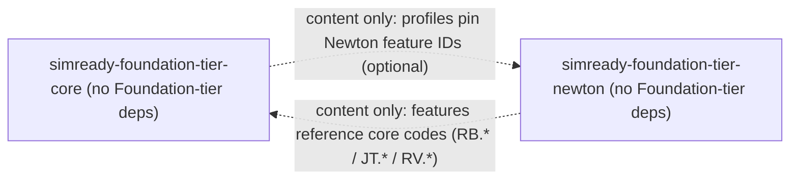

# Proposal: Extract Newton into a dedicated `tier_newton`

- **Status:** Draft for review (no code moved yet)
- **Scope owner:** SimReady Foundation
- **Related:** `nv_core/tiers/simready_foundation_tier_core`, `nv_core/tiers/simready_foundation_tier_sensors`

## 1. Summary and locked decisions

Today all Newton content ships inside `simready-foundation-tier-core`: Newton
features, Newton requirements, and Newton validator logic that is interwoven
with the Standard / PhysX / MuJoCo checkers. This proposal describes moving the
Newton *physics* surface into a new, **independent** `simready-foundation-tier-newton`
tier that has **no package dependency on `tier-core`** (and keeps `tier-core`
dependency-free), so an environment that does not need Newton does not carry it,
and so Newton can evolve on its own cadence.

The following decisions are already agreed and this plan is written to them:

| Decision | Choice |
|---|---|
| Deliverable | Write this plan first; execute only after approval. |
| Requirement scope | Move only the Newton-namespaced `NEWTON.*` physics requirements + their validators, plus the six Newton features. **Leave** the shared `runtime_variants` `RV.004-006` Newton scaffolding (and `RV.010/011` purity) in `tier-core`. |
| Tier independence | **Core has no dependencies; `tier-newton` has no dependency on `tier-core`.** Neither package imports the other or lists it in `pyproject`. The only cross-tier links are runtime *content* references (Newton features -> core requirement/feature IDs; core profiles -> Newton feature IDs), resolved from the merged registry when both tiers are installed. |
| Validator coupling | `tier-newton` is code-independent: it **duplicates** the few small shared helper functions the Newton checkers use instead of importing them from core. |
| Conform skills | Handled in a later phase. Principle of record: a feature's conform skill lives with whatever tier owns the feature, so the Newton conform skills move to (or alongside) `tier-newton` when we get to skills. |
| Profiles | Stay in `tier-core`; they keep pinning the Newton features by ID as **optional** — a soft content reference, not a package dependency, resolved when `tier-newton` is installed. |

Because requirement code strings (`NEWTON.COL.001`, `RV.004`, ...) and feature
IDs/versions (`FET_003_NEWTON@0.1.0`, ...) are **unchanged**, this is an
ownership/packaging move, not a contract change. Nothing here bumps a feature
version or renames a requirement.

### 1.1 Dependency and independence (at a glance)



- **Package/build edges: none in either direction.** Neither tier imports the
  other or lists it in `pyproject`. `tier-core` stays dependency-free, and
  `tier-newton` adds no Foundation-tier dependency.
- **The dashed edges are runtime *content* references only** (ID/code strings),
  resolved from the merged registry when both tiers are installed. They are not
  build/install dependencies and create no import cycle — a content reference in
  each direction is fine precisely because neither is a package edge.
- **Shared validator helpers are duplicated** into `tier-newton`, not imported
  from core (see §6.4).
- **Supported deployment:** install both tiers together for full Newton
  validation; installing `tier-newton` alone cannot resolve the core codes its
  features reference (see §9).

## 2. How a tier works (recap)

Each tier is a self-contained, additive Python distribution under
`nv_core/tiers/simready_foundation_tier_<name>/`:

- `simready/foundation/<name>/` with generic `__init__.py`, `_tier.py`,
  `_plugin.py` (identical across tiers; they derive their name from
  `__package__`), plus `capabilities/`, `features/`, `profiles/`.
- `pyproject.toml` with two entry points:
  - `usd_validation_nvidia` -> `...:SimReadyPlugin` (importing the tier's
    `capabilities` hub registers every validator via its `@register_rule` /
    `@register_requirements` decorators).
  - `simready.tier` -> `...:tier` (exposes the requirements module + features +
    profiles dirs as per-layer content sources).
- A shared Hatch build hook (`nv_core/tiers/_tooling/build_hook.py`) generates
  the requirements-enum module from the tier's committed `capabilities/`
  markdown into `_build/python/<module>/requirements`, force-included into the
  wheel.
- Optional `simready_benchmark_kit_suite/` and `tests/`.

Registration is layered: **features and profiles reference requirement/feature
IDs by string**, and the loader registers all installed tiers' requirements,
then all features, then all profiles. The design therefore *should* resolve a
`tier-newton` feature that references a `tier-core` requirement code from the
merged registry, provided `tier-core` is installed.

> **Assumption to verify (Phase-1 gate).** No tier in this repo currently
> demonstrates a cross-tier feature -> requirement reference: every `sensors`
> feature references only sensors-owned codes (`PS.*`, `RP.*`, `LI.*`), and the
> Newton features today sit in the same tier as the `RB.*`/`JT.*`/`RV.*` codes
> they reference. Before moving anything, confirm the loader resolves feature
> requirement lists (and cross-tier feature *dependencies*) from the merged
> multi-tier registry rather than only within the owning tier. If it resolves
> only within-tier, this whole plan needs a different split (see Section 9).

## 3. Newton footprint in `tier-core` (inventory)

### 3.1 Features (6 pairs, `features/`)

| Feature | Requirements it lists | Notes |
|---|---|---|
| `FET_000_NEWTON@0.1.0` | `RV.004`, `RV.005`, `RV.006`, `RV.010`, `RV.011` | References **only core** `RV.*` (all staying in core). Depends on `FET_000_STANDARD`. |
| `FET_003_NEWTON@0.1.0` | `RB.*` (core) + `NEWTON.COL.001/002`, `NEWTON.MAS.001`, `NEWTON.MAT.001` | Mixed. |
| `FET_004_NEWTON@0.1.0` | `JT.*`, `RB.MB.001`, `RB.011/012` (all core) | References **only core**. Depends on `FET_003_NEWTON`. |
| `FET_004_ROBOT_NEWTON@0.1.0` | `RB.*`, `JT.*` (core) + `NEWTON.COL/MAS/MAT` | Mixed. |
| `FET_022_NEWTON@0.1.0` | `DJ.011` (core) + `NEWTON.DJ.001/002/003` | Mixed. Depends on `FET_004_ROBOT_NEWTON`. |
| `FET_024_NEWTON@0.1.0` | `NEWTON.BA.001` | Depends on `FET_024_STANDARD` (core). |

### 3.2 Requirements (11 docs) — two kinds

**A. Newton-namespaced `NEWTON.*` (8) — MOVE to `tier-newton`.** Each lives in a
shared capability folder and has a dedicated validator:

| Code | Requirement doc (capability) | Validator class |
|---|---|---|
| `NEWTON.BA.001` | `physics_bodies/base_articulation` | `NewtonArticulationRootConfig` |
| `NEWTON.DJ.001` | `physics_bodies/physics_driven_joints` | `NewtonJointDriveAPIChecker` |
| `NEWTON.DJ.002` | `physics_bodies/physics_driven_joints` | `NewtonJointAttributesChecker` |
| `NEWTON.DJ.003` | `physics_bodies/physics_driven_joints` | `NewtonMimicAPIChecker` |
| `NEWTON.MAT.001` | `physics_bodies/physics_materials` | `NewtonMaterialAttributesChecker` |
| `NEWTON.COL.001` | `physics_bodies/physics_rigid_bodies` | `NewtonColliderAPIChecker` |
| `NEWTON.COL.002` | `physics_bodies/physics_rigid_bodies` | `NewtonSDFAttributesChecker` |
| `NEWTON.MAS.001` | `physics_bodies/physics_rigid_bodies` | `NewtonMassAttributesChecker` |

**B. Shared runtime-variant `RV.*` (3) — STAY in `tier-core`.** `RV.004`
(`newton-variant-set`), `RV.005` (`newton-runtime-payload`), `RV.006`
(`newton-variant-metadata`) are the Newton third of a symmetric per-runtime
scheme (`RV.001-003` PhysX, `RV.004-006` Newton, `RV.007-009` MuJoCo,
`RV.010-011` shared purity/isolation) in `core/runtime_variants`. Their
checkers (`NewtonVariantSetChecker`, `NewtonRuntimePayloadChecker`,
`NewtonVariantMetadataChecker`) subclass shared base classes, and the `RV.010/011`
purity checker explicitly reasons about Newton. Splitting these out would
fragment the `RV` numbering across tiers and leave core's purity checker
referencing content it no longer owns, so they remain in core.

### 3.3 Validator logic — interwoven, not modular

Every Newton checker currently lives *inside a shared* `validation.py`:

- `core/runtime_variants/validation.py` (RV Newton checkers — **stay**).
- `physics_bodies/base_articulation/validation.py` (`NewtonArticulationRootConfig`).
- `physics_bodies/physics_driven_joints/validation.py` (`NewtonJointDriveAPIChecker`,
  `NewtonJointAttributesChecker`, `NewtonMimicAPIChecker`).
- `physics_bodies/physics_materials/validation.py` (`NewtonMaterialAttributesChecker`).
- `physics_bodies/physics_rigid_bodies/validation.py` (`NewtonColliderAPIChecker`,
  `NewtonSDFAttributesChecker`, `NewtonMassAttributesChecker`).

The eight moving checkers all inherit directly from
`usd_validation_nvidia.BaseRuleChecker` (no custom shared base class), so the
only `tier-core` coupling is a set of **module-private helper functions** — some
generic/shared, some Newton-specific.

### 3.4 Benchmark and unit tests (deferred phase)

- `simready_benchmark_kit_suite/fet004_multibody/newton_drive.py`
- `simready_benchmark_kit_suite/fet005_grasp/newton_articulation.py`
- `tests/runtime_tests/unit/test_fet004_newton_drives.py`
- `tests/runtime_tests/unit/test_newton_articulation.py`

These are Newton-specific scripts sitting *inside shared test families*, not in
Newton-only folders. See Section 8.

### 3.5 Consumers that reference Newton (become cross-tier)

- Profiles in `tier-core`: `robotics_prop.toml`, `robot_body.toml`
  (`2.1.0`/`2.2.0`), `robot_gripper.toml` (`2.1.0`/`2.2.0`) pin the six Newton
  features as **optional**.
- Shared docs: `shared/features/feature-dependency-graph.md`,
  `shared/features/features.md`, `shared/profiles/profiles.md`,
  `shared/tiers/core.md`, `shared/tiers/tiers.md`.
- Repo-level skills: `skills/simready-foundation-conform-fet-{000,003,004,004-robot,022,024}-newton` (deferred).

## 4. What moves vs. what stays

**Moves to `tier-newton`:**

- The 6 Newton feature files (`.md` + `-0.1.0.json`) verbatim.
- The 8 `NEWTON.*` requirement docs.
- The 8 `NEWTON.*` validator classes plus their Newton-private helpers/constants.
- (Later) the Newton benchmark scripts, Newton unit tests, and Newton conform skills.

**Stays in `tier-core`:**

- `RV.004-006` Newton runtime-variant scaffolding + their checkers, and `RV.010/011` purity.
- All Standard / PhysX / MuJoCo requirements and validators.
- All requirements the Newton features reference by ID (`RB.*`, `JT.*`, `DJ.011`, `RV.*`).
- The `tier-core` profiles (they keep their optional Newton pins).
- Shared/generic helper functions used by core checkers stay in core, untouched; `tier-newton` gets its **own duplicated copies** (no cross-tier import — see 6.4).

## 5. Target `tier-newton` layout

```text
nv_core/tiers/simready_foundation_tier_newton/
|-- pyproject.toml
|-- README.md
|-- docs-sources.json
|-- simready/foundation/tier_newton/
|   |-- __init__.py            # exports SimReadyPlugin + tier (verbatim from a tier)
|   |-- _plugin.py             # verbatim
|   |-- _tier.py               # verbatim
|   |-- capabilities/
|   |   |-- __init__.py        # hub: imports each Newton validation module
|   |   `-- physics_bodies/
|   |       |-- base_articulation/     (newton-articulation-root-config.md + validation.py)
|   |       |-- physics_driven_joints/ (newton-joint-*.md, newton-mimic-api.md + validation.py)
|   |       |-- physics_materials/      (newton-material-attributes.md + validation.py)
|   |       `-- physics_rigid_bodies/   (newton-collider/mass/sdf.md + validation.py)
|   |-- features/              # the 6 FET_*_NEWTON pairs
|   `-- profiles/              # empty for now (no Newton-only profile yet)
`-- (later) simready_benchmark_kit_suite/ + tests/
```

Each moved capability folder keeps its **same name** as in core (e.g.
`physics_bodies/base_articulation`) so the generated enum class name
(`BaseArticulationRequirements`) matches what the moved validator imports; the
folder in `tier-newton` contains only the Newton requirement doc(s), so
`tier-newton`'s generated enum exposes only the `NEWTON_*` members. No code
collision occurs because requirement codes are globally unique and the two
enum modules live in different packages.

## 6. Design details

### 6.1 Package scaffolding

Copy `_tier.py`, `_plugin.py`, `__init__.py` verbatim (they self-derive
`tier_newton` from `__package__`). New `pyproject.toml` modeled on the sensors
tier:

- `name = "simready-foundation-tier-newton"`.
- Entry points `usd_validation_nvidia` = `simready.foundation.tier_newton:SimReadyPlugin`
  and `simready.tier` = `simready.foundation.tier_newton:tier`.
- Build hook `module = "simready.foundation.tier_newton"`,
  `reverse_domain = "com.nvidia.simready"`, force-include the generated
  `requirements` package.
- **No Foundation-tier dependency:** `tier-newton` lists no dependency on
  `simready-foundation-tier-core`. The moved validators use **duplicated**
  helpers (not imports), and the Newton features' references to core requirement
  codes are runtime content references resolved from the merged registry when
  core is also installed — not a package dependency. Runtime deps mirror the
  sensors tier (`usd-validation-nvidia`, `numpy`).

### 6.2 Capabilities and requirement docs

Move the 8 `NEWTON.*` requirement markdown files into the mirrored capability
folders under `tier-newton/.../capabilities/physics_bodies/...`. Delete them
from the corresponding `tier-core` capability folders and drop their entries
from those capabilities' `requirements.md` index pages. The `tier-newton`
`capabilities/__init__.py` hub imports each new Newton `validation` module so
the plugin registers them on startup.

### 6.3 Requirements-enum codegen implications

The build hook regenerates each tier's enum from its own `capabilities/`
markdown. After the move:

- `tier-core`'s generated `requirements` module **no longer contains** the
  `NEWTON_*` members (e.g. `BaseArticulationRequirements.NEWTON_BA_001`).
- `tier-newton`'s generated `requirements` module **gains** them.

Action item: any code in `tier-core` that imported `...requirements` and
referenced a `NEWTON_*` member must be part of the moved set (it is — those
references live only in the Newton validators being moved). A grep for
`NEWTON_` against the core `requirements` import surface is a Phase-1 gate to
prove no core module is left referencing a moved enum member.

### 6.4 Validator extraction (duplicate helpers)

For each moving checker, classify the module-private helpers it calls:

- **Shared/generic** (used by Standard/PhysX/MuJoCo too) -> **duplicate** into a
  `tier-newton`-local helper module; leave the original in `tier-core` untouched.
- **Newton-specific** -> move with the checker into the `tier-newton` module.

Worked example — `NewtonArticulationRootConfig` (`NEWTON.BA.001`):

- Shared helper it uses: `_has_applied_api_schema(prim, schema_name)` — generic,
  shared with the Standard/MuJoCo articulation checkers -> **copied** into
  `tier-newton` (core keeps its own copy, unchanged).
- Newton-specific it uses: `_has_authored_newton_self_collision_attr(prim)` and
  constants `_NEWTON_ARTICULATION_ROOT_API`, `_NEWTON_SELF_COLLISION_ATTR` ->
  move with the class.
- Requirement enum: uses `tier-newton`'s generated
  `BaseArticulationRequirements.NEWTON_BA_001`.

Duplication strategy: put the copied helpers in one small
`tier-newton/.../capabilities/_common.py` (or per-capability copies) so the
duplication is explicit and greppable. The set is small (schema-presence checks
and a few traversal helpers). Because core does not change, there is no
shim/export work on the core side and — critically — **no import edge between the
two tiers in either direction**.

Per-file Phase-1 audit deliverable: a table of each of the 8 checkers ->
{shared helpers to duplicate, Newton-private helpers/constants it takes with it,
requirement-enum members it references}. Keep the duplicated set minimal and
record it for future sync.

### 6.5 Feature files

Move the six `FET_*_NEWTON.md` + `-0.1.0.json` verbatim. IDs and versions are
immutable and unchanged. `FET_000_NEWTON` and `FET_004_NEWTON` reference only
core requirement codes; the other four reference a mix of core + moved
`NEWTON.*` codes. All resolve from the merged registry.

### 6.6 Cross-tier resolution

- **Feature -> requirement (cross-tier):** e.g. `FET_003_NEWTON` (in newton)
  references `RB.001` (core) + `NEWTON.COL.001` (newton). Resolved from the
  merged requirement registry.
- **Feature -> feature dependency (cross-tier):** `FET_024_NEWTON` depends on
  `FET_024_STANDARD` (core); `FET_000_NEWTON` depends on `FET_000_STANDARD`
  (core). The Newton feature dependency chain
  (`FET_022_NEWTON -> FET_004_ROBOT_NEWTON -> FET_003_NEWTON`) stays within
  `tier-newton`.
- **Profile -> feature (cross-tier):** `tier-core` profiles keep the Newton
  pins by ID; validating those optional gates now requires `tier-newton`
  installed. See risks (Section 9).

## 7. Consumers to update

- **Profiles:** no ID/version change needed in the three TOMLs; keep the pins.
  Optionally refresh the inline comments to note the feature's owning tier.
- **Shared docs:** update `shared/tiers/tiers.md` to list the new tier; add a
  `shared/tiers/newton.md` catalog page; move the Newton feature rows out of the
  core catalog in `shared/tiers/core.md`; keep the Newton nodes in
  `feature-dependency-graph.md` and `features.md` but note the owning tier.
- **`AGENTS.md`:** update the "Important Files" and tier notes so the Newton
  features/requirements are documented as `tier-newton`-owned.
- **README / install docs:** document `pip install simready-foundation-tier-newton`.
  It does **not** pull `tier-core` (no dependency); for full validation of a
  robot/prop profile's Newton gates, install both tiers together
  (`pip install simready-foundation-tier-core simready-foundation-tier-newton`).
- **Build/CI:** confirm `./repo.sh build_tiers` and the tier build glob pick up
  the new tier directory automatically (verify `build_tiers.py` enumerates
  `nv_core/tiers/simready_foundation_tier_*`).

## 8. Deferred phases

- **Conform skills:** the 7 `simready-foundation-conform-fet-*-newton` skills
  move to live with `tier-newton` (per the recorded principle). Until then they
  stay in `skills/` and get their tier references updated.
- **Benchmark scripts:** `newton_drive.py` and `newton_articulation.py` live
  inside shared `fet004`/`fet005` suites. Moving them into a `tier-newton`
  `simready_benchmark_kit_suite` requires the benchmark harness to discover and
  merge suites from multiple tiers; scope that separately.
- **Unit tests:** move the two Newton unit tests alongside the tier they cover.

## 9. Risks and breaking changes

- **Cross-tier resolution is unproven (blocking assumption):** the entire plan
  rests on the loader resolving a feature's requirement list and feature
  dependencies from the *merged* multi-tier registry. It is not demonstrated
  in-repo today (Section 2). If resolution is within-tier only, the fallback is
  to keep the Newton features whose requirement lists include core codes in
  `tier-core` and move only the self-contained `NEWTON.*` requirements +
  validators, or to make `tier-newton` re-declare/alias the referenced codes —
  both are worse. Verify first.
- **Standalone `tier-core` validation of Newton gates:** once the Newton
  requirements/validators leave core, validating a profile's optional Newton
  gates without `tier-newton` installed will not evaluate them. Because the
  pins are optional this is acceptable, but the profile docs/README must say so.
- **Package-independent is not "usable with core absent":** choice A gives
  `tier-newton` no package/build dependency on core (no import or `pyproject`
  edge — the goal of the "no dependency on core" requirement). But its feature
  contracts still reference core codes (`RB.*`/`JT.*`/`RV.*`), so installed
  *without* core those references do not resolve and the Newton features cannot
  be fully validated. The supported deployment is **both tiers installed
  together**. (Full isolation would be choice B — reference/duplicate only
  Newton-owned codes — which was not selected.)
- **Enum import surface:** downstream code importing
  `tier_core...requirements` `NEWTON_*` members breaks; those members now live
  in `tier_newton...requirements`. Mitigated by the Section 6.3 grep gate.
- **Shared-helper duplication drift:** the helpers copied into `tier-newton`
  (e.g. `_has_applied_api_schema`) must be kept in sync if core changes them.
  They are small and stable; record the duplication so a future change updates
  both. This is the deliberate cost of zero cross-tier imports, and it keeps
  `tier-core` completely untouched by the extraction's validator work.
- **Two tiers with same-named capability folders:** intentional and safe (unique
  codes, distinct modules), but worth a note so reviewers do not "consolidate".

## 10. Phased roadmap

0. **Prove cross-tier resolution (gate).** With `tier-core` + `sensors`
   installed, add a throwaway probe (or inspect the loader) confirming a feature
   in one tier can reference a requirement code and a feature dependency owned by
   another tier. Do not proceed until this passes.
1. **Scaffold** `tier-newton` (package files, `pyproject.toml`, empty
   `capabilities/features/profiles`, README, docs-sources). Wire `build_tiers`.
2. **Duplicate the shared helpers** into `tier-newton` (a small `_common.py`).
   `tier-core` is not modified for this.
3. **Move `NEWTON.*` requirement docs** into `tier-newton` capabilities; drop
   from core `requirements.md` indexes; run the codegen grep gate (6.3).
4. **Move the 8 Newton validators** into `tier-newton` modules, using the
   duplicated helpers and the new enum; delete them from core `validation.py`;
   register via the new capabilities hub.
5. **Move the 6 Newton feature files** into `tier-newton/features`.
6. **Update consumers** (docs, README, AGENTS.md; keep profile pins).
7. **Validate:** build both wheels; run `simready-validate` on a Newton sample
   with both tiers installed; confirm all previously-passing Newton gates pass
   and core-only validation is unaffected.
8. **Deferred:** skills, benchmark scripts, unit tests (Sections 8).

## 11. Open decisions

- **Duplicated-helper location:** a single `tier-newton/.../capabilities/_common.py`
  vs. per-capability copies. (Lean: one documented `_common.py`.)
- **`tier-newton` version:** initial `0.0.1a1`. **No `tier-core` floor is pinned**
  (no dependency); document the recommended paired install instead.
- **Newton-only profile:** none today; do we want a `Newton-*` profile in
  `tier-newton/profiles`, or leave Newton purely as optional gates in the core
  robot/prop profiles? (Lean: no new profile now.)
- **Benchmark multi-tier discovery:** required before Newton benchmark scripts
  can leave core — confirm the harness merges suites across tiers.
